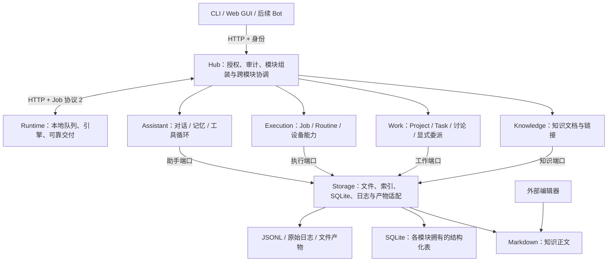

# Lumio 设计（总览）

> **现行设计由本文件和 [`design/`](design/) 下的分册组成**，只写现在生效的规则与边界，不保留历史，不写功能清单和进度。
> 本文件写目标、总体结构、工程基础、存储权威和流程；各模块的规则在分册里。AI 开工时读本文件，再读任务说明里列出的分册（ADR 0036）。
> 规则后的 `ADR 00xx` 说明出处，想知道"为什么"时再去查；小改动可以只标任务或 PR 编号（ADR 0036）。

> **四模块重构**：[ADR 0025](adr/0025-four-module-architecture.md)（Accepted，2026-10-31 人类批准）规定知识、工作、执行、助手四模块与混合存储，
> 已于 2026-11-02 合并（#62）：四模块边界、业务存储、日志备份与显式迁移已实现，验收证据见 [R0-0](tasks/R0-0-four-module-refactor.md)。Project/Task 的 Markdown 展示与导出派生物尚未实现。真实数据迁移需按 [migration-v2](migration-v2.md) 单独执行。

> **已批准、本地验收中**：[ADR 0034](adr/0034-knowledge-creation-and-authoring.md) 第 1–5 节（知识新建入口与模板，[K1-0](tasks/K1-0-knowledge-authoring.md)）与
> [ADR 0035](adr/0035-live-note-editing-and-related-notes.md) 第 1–8 节（实时编辑、相关推荐、`[[` 候选与上标脚注，[K2-0](tasks/K2-0-live-note-editing.md)）均于 2026-11-06 获批准并已合并（#99），规则已写入 [`design/knowledge.md`](design/knowledge.md)。PDF 与 RAG 不在本期。

## 0. 目标与非目标

**目标**：在一个地方管理论文笔记、外部资料、想法、项目与任务、实验结果、发布内容和个人资产；
把想法通过链接串成报告；把工作派给 Mac 或服务器上的 AI，并支持定时工作流。

**非目标**（至少在 P3 之前）：自己写编辑器、复杂的多 agent 协作与模型路由、多用户与托管服务、完整的 AI 权限系统
（只预留接口，见 [`design/security.md`](design/security.md)）、与飞书双向同步正文、同步第二份 vault。

## 1. 总体结构

四个业务模块互不导入实现。每个模块内部由业务用例组织规则，通过注入的存储/模型/工具端口使用外部能力；
Storage 实现持久化，Hub 完成组装和跨模块协调。共用一个 SQLite 文件是为本地事务服务，不表示各模块可以互读内部表。
跨模块通过稳定 ID、ResourceRef 与公开接口协作，Work 与 Execution 的关联由 Hub 在同一事务内协调。

Foundation 提供 ID 和错误；Platform 提供终端、诊断、下载与升级。Schema 是唯一格式来源，API Client 只负责 HTTP。
网络和进程能力留在应用/适配器中，领域包不做 I/O。Runtime 是独立应用，不能 import Hub，也不要求有 Task 或知识目录。

- **vault 是知识的唯一事实来源**：一个装 Markdown + YAML frontmatter 的普通文件夹，任何编辑器都能改；Lumio 不依赖、不读写任何编辑器的配置。
  用外部编辑器改文件是一直支持但最不正式的用法，正式的编辑方式以后由官方 GUI 提供（ADR 0001、0007、0022）。默认位置 `~/.config/lumio/vault`，安装时可改。
- **一套系统只有一个 Hub**，vault 在 Hub 所在的机器上。这个文件夹可以被任何外部工具（git、Syncthing、iCloud……）同步到别的设备上编辑，
  同步进来的修改等同于人改文件；Lumio 不做自己的同步（ADR 0017、0022）。
- `index.sqlite` 是可重建的知识索引，`refs.bib` 是生成物；`hub.sqlite` 保存身份、执行记录以及新版 Work/Assistant 业务数据，不能删除后靠 vault 重建（ADR 0014、0025）。
- **知识与工作独立**：知识正文仍由文件负责，数据库任务与项目由 Work 负责；Work 可以在未配置 `LUMIO_VAULT` 时使用。
  Task 描述使用 Markdown 语法，但不因此成为知识笔记；各模块通过 ID 和公开接口协作（ADR 0025）。

## 2. 工程基础

- **一个代码仓库**，数据（vault）不放在仓库里（ADR 0001）。
- **全部 TypeScript，运行在 Bun 上**；开发、测试、CI、发布与人类的 Nix 环境统一使用 `package.json` 的 `packageManager` 指定的 Bun 1.4.4（ADR 0002，AGENTS.md；2026-11-08 人类批准 Bun 1.4 升级）。
- 全部角色用 `bun build --compile` 编译成**一个程序** `lumio`，以子命令区分 `lumio hub …`、`lumio runtime …`；`lumio-hub`、`lumio-runtime` 是指向它的兼容链接（ADR 0002、0027）。
- **界面语言**（ADR 0028）：面向人的输出默认英文，中文环境用中文。命令行按 `LUMIO_LANG`、`LC_ALL`、`LC_MESSAGES`、`LANG` 的第一个非空值判断（`zh` 开头用中文）；
  后台服务日志固定英文；Hub 的错误说明按请求 `Accept-Language` 选择，`code` 不变、客户端不依赖文字判断；Web 可切换并保存在浏览器。
  文案集中在各 app 的中英两张同键文案表里（测试保证一致）；库代码只抛带 `code` 与参数的错误，由 app 层翻译。不引入 i18n 依赖。开发文档仍用中文。
- **终端输出**（ADR 0028）：着色遵循 `NO_COLOR`、`FORCE_COLOR`，非终端与 `TERM=dumb` 不着色；检查结果分通过、提醒、失败三级，只有失败计入未通过与非零退出码。
- **契约**：`packages/schema` 中的 Zod 定义是数据格式的唯一事实来源；其他语言用 `bun run schema:export`
  导出的 JSON Schema（ADR 0003）。vault 实体用宽松对象（未知字段原样保留），协议用严格对象（未知字段拒绝）。

| 模块 | 职责 | 可以依赖 |
|---|---|---|
| `packages/schema` | 契约 | 仅 zod |
| `packages/knowledge` | 知识规则、解析/补全/链接、论文创建与查询用例；不做 I/O | schema, foundation，已有 YAML/XML 解析依赖 |
| `packages/work` | 数据库项目/任务、依赖、讨论、输入快照、显式委派用例；不做 I/O | schema |
| `packages/execution` | Job 生命周期、设备名称/能力/在线事实、取消与执行有效性、数据库 Routine 计划与历史输入、cron；不做 I/O | schema, foundation |
| `packages/assistant` | 对话、上下文、Agent 循环、工具记录与恢复；通过接口调用模型 | schema |
| `packages/storage` | 各领域的 SQLite、知识文件与索引适配器 | schema 与业务包公开接口 |
| `packages/foundation` | 稳定 ID 与带 code 的基础错误 | schema |
| `packages/platform` | 终端、下载、升级回退、诊断与配对/Hub 检查；显示和版本由应用传入 | schema |
| `packages/core` | 旧包兼容转发入口，已无上述具体实现；应用禁止再依赖 | 上述内部包 |
| `packages/api-client` | 调用 Hub 的 SDK | schema |
| `apps/cli` | 唯一程序入口 `lumio`：命令行（联网获取论文元数据、本地知识模式、Hub 客户端），并分派 `hub`、`runtime` 子命令 | api-client, knowledge, storage, foundation, platform, schema；以及 `apps/(hub\|runtime\|web)/src/entry.ts`（ADR 0027） |
| `apps/hub` | API、模块组装、跨模块协调、身份与旧路径兼容 | 业务包、storage、foundation、platform、schema |
| `apps/runtime` | 设备 daemon，与 Hub 只走 HTTP | execution 的纯计划能力、storage 的日志适配、foundation、platform、schema |
| `apps/web` | 中文 GUI 与静态资源构建，入口 `src/entry.ts`；网页由 Hub 提供（ADR 0027） | api-client, schema |
| `apps/feishu-bot` 等 | 后续客户端 | api-client |

依赖方向由 `bun run lint:deps` 强制：`packages` 不依赖 `apps`，`apps` 之间不互相依赖——唯一例外是 `apps/cli` 可以引用其他 app 的入口模块 `src/entry.ts`，hub、runtime、web 之间仍不互相引用（ADR 0027）；四个业务包不导入其他业务包实现或具体适配器，禁止文件/网络/SQLite/进程 I/O；应用不依赖 Core 兼容汇总入口（ADR 0025）。

## 3. 存储权威与备份

| 数据 | 权威来源 | 其他格式的作用 |
|---|---|---|
| 知识正文、知识元数据、人的链接 | vault 中 Markdown + frontmatter | index.sqlite / refs.bib 可重建 |
| Project / Task / 描述 / 讨论 / 依赖 / 委派关联 | hub.sqlite 中 Work 表 | 描述采用 Markdown 语法；外部编辑的是带版本副本，任务结局与交接经 Lumio 修改 |
| Job / Routine / 输入计划 / 设备能力 | hub.sqlite 中 Execution 表 | Runtime 本地 SQLite 保存队列、结果与归档待交付记录 |
| 助手对话 / 轮次 / 工具状态 / 显式记忆 | hub.sqlite 中 Assistant 表 | 模型供应商的会话不是本地权威 |
| 执行过程、原始输出、附件 | 有格式版本的 JSONL / 原始日志 / 文件 | SQLite 保存归属、摘要、大小和 staged/ready 状态；日志不决定任务当前状态 |

正文用 Markdown 语法，不意味着每个业务对象必须对应一份知识文件。JSON 用于配置、快照和接口，JSONL 用于逐行过程记录与分段交付；
二者都不作为反向修改 Task 状态的控制入口。知识目录单独备份；业务库必须连同其引用文件做一致性快照并验证清单，不能删除重建。
旧 Task/Project/Routine Markdown 只在迁移前走兼容路径，切换后是保留原文和链接的历史来源；不与数据库双向同步。

## 4. 分册

| 分册 | 内容 |
|---|---|
| [`design/knowledge.md`](design/knowledge.md) | vault 目录、实体类型、元数据补全、citekey、链接与 AI 区块、自动提交、搜索 |
| [`design/work.md`](design/work.md) | 数据库项目与任务：任务模型、交接计划、通知、提问与验收、CLI |
| [`design/execution.md`](design/execution.md) | 执行器与 Job、日志与托管文件、旧任务笔记兼容、数据库 Routine |
| [`design/assistant.md`](design/assistant.md) | 内置助手：对话、模型适配、显式记忆、工具状态 |
| [`design/hub.md`](design/hub.md) | Hub 的职责、运行数据存放与备份、部署与安装、旧数据迁移 |
| [`design/web.md`](design/web.md) | Web 工作台 |
| [`design/security.md`](design/security.md) | AI 协作与权限、身份与令牌、审计、私密实体、卡号防护、委派的安全底线 |

**体积上限**（ADR 0036）：本文件和每个分册各不超过 15 KB（约 5000 个汉字）。超出说明混进了功能细节，在造成超出的 PR 里精简；
做不到时告诉人类。阶段与进度不写在这里，见 [`tasks/README.md`](tasks/README.md)。

## 5. 流程

- **什么时候写 ADR**（ADR 0036）：只有架构级决定才写——改 `packages/schema` 契约或协议、改模块边界或依赖方向、
  改权限或安全模型、改存储格式或需要迁移数据、改发布包格式或升级兼容、或者认真否决过有分量的备选方案。
  拿不准时问两个问题：半年后会不会有人问"为什么不用另一种做法"？改回来要不要迁移数据或改契约？两个都是"否"就不写。
- **不写 ADR 的改动**：改变现行规则但没有争议的（默认值、新增命令选项等）直接改本文件或分册，标任务或 PR 编号；
  不改变任何规则的（加按钮、改样式、修 bug、模块内部重构）只写任务说明或 PR 描述，设计文档不动。
- **设计文档只写规则与边界**：不写界面交互细节、完整命令表（以 `--help` 和代码为准）、实现步骤和进度。
- **ADR 的生命周期**（ADR 0013）：`Proposed` 随便改 → `Accepted` 修改要人类批准并记修订记录 →
  `Implemented` 定稿，要改就写新的 ADR；部分实现时，已实现的小节先定稿。
- **设计文档与 ADR 同步**（ADR 0015）：改 ADR 的 PR 必须同时改本文件或对应分册；反过来，改设计文档不要求写 ADR（ADR 0036）。
- **同一工作树单会话写入，独立 worktree 与独立分支允许并行开发和测试**（V0-0）；用 `git fetch` 更新远端引用，从明确的已提交版本建立干净的工作树，不触碰其他会话的未提交改动。测试状态、数据库、端口与客户端目录隔离；部署、服务重启、发布等共享操作串行协调。结束时检查、提交并推送自己的改动，安全归档不再使用的 worktree；完整规则见 AGENTS.md 第 10 条。
- **主线开发**：功能分支经完整 CI（以及安排了的 review）合入 `main`；由谁 review、何时合并由 Lumio 交接计划或人类安排，没有安排时按 `AGENTS.md` 第 9 条的默认流程（ADR 0049）。本机仅部署到日常实例 7420，始终从主线构建，人类在合并后的主线上验收。正式发布使用主线上已验收提交的 `v*` 标签。见 [主线开发与本机部署](local-deployment.md)。
- **分工**：习惯上后端 Codex、前端 Claude，`packages/schema` 由 Claude 起草、人类批准；这是默认习惯，不是委派规则（AGENTS.md、ADR 0049）。
- **任务说明**（`docs/tasks/`）：一个纵向切片一份，承载这个切片的具体需求；写明要读哪些分册；PR 合并时把实现了的 ADR 小节标为已实现。

## 旧节号对照

2026-11-06 之前的 ADR 与任务说明按旧节号引用本文件（ADR 0036 拆分前）：

| 旧节号 | 现在的位置 |
|---|---|
| 0、1、2 | 本文件第 0、1、2 节 |
| 3.0 | 本文件第 3 节 |
| 3.1–3.5、4.3、4.4 | [`design/knowledge.md`](design/knowledge.md) |
| 4.1、4.2、4.5 | [`design/hub.md`](design/hub.md) |
| 4.2.1、4.6 | [`design/execution.md`](design/execution.md) |
| 4.7 | [`design/work.md`](design/work.md)；Routine 与设备在 [`execution.md`](design/execution.md)，助手在 [`assistant.md`](design/assistant.md)，迁移在 [`hub.md`](design/hub.md) |
| 4.8 | [`design/web.md`](design/web.md) |
| 5、6 | [`design/security.md`](design/security.md) |
| 7 | 本文件第 5 节 |
| 8（阶段） | [`tasks/README.md`](tasks/README.md) |
