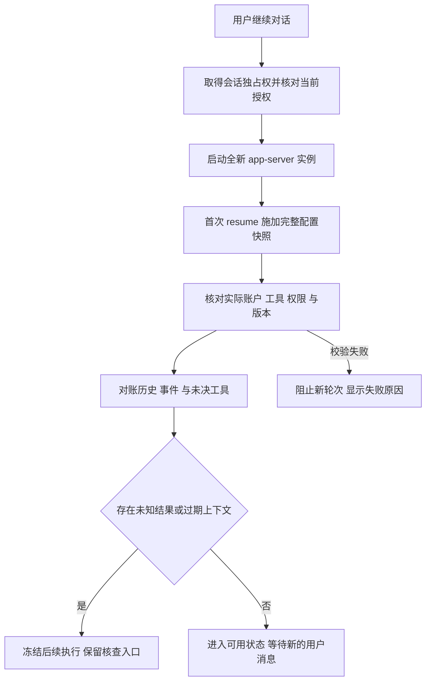

# Codex Assistant 方案收敛与 ADR 修订交接

状态：**待 Claude 修订、待人类审阅的方案建议**。日期：2026-11-08。依据：[V0-0 验证报告](V0-0-spike-report.md)，实测 Codex 0.166.0。本文件不修改现行设计、正式 ADR 或契约，也不把下述建议视为已经批准。

首版采用 **Lumio 管业务对话与权限，Runtime 独占管理官方 Codex 会话**：每个原生 Runtime Session 独占一个 app-server 进程及持久状态目录；重新启动时先恢复并核对完整环境，再允许新的用户轮次。工具执行结果未知时冻结后续执行，不能靠重新发送用户消息恢复。

这里的“Assistant 会话”指业务 conversation 的一个原生后端绑定，不是 Assistant 配置对象；同一 Assistant 下的两个 conversation 仍需独立隔离。

## 1. 首版决定

| 项目 | 收敛后的建议 |
|---|---|
| 原生后端 | 只做官方 Codex app-server；API 后端保留 Lumio 原有循环。Claude 原生订阅、pi 内核等不并入本期 |
| 业务入口 | Web → Hub → Execution 实时通道 → Runtime → 官方 app-server；浏览器不直连执行器 |
| 引擎循环 | native 一轮只由 Codex 跑循环；Lumio 交付上下文、提供 MCP、展示事件，不再套一层模型循环 |
| 进程与状态 | 每个 Runtime Session 独占进程、进程运行实例标识、持久 CODEX_HOME、工作目录和本地事件队列；不做进程池 |
| 并发 | 同一 Runtime Session 同时一轮；不同 session 可并行，不因复用 Profile 而共用权限或进程 |
| 默认权限 | workspace-write、命令网络关闭、on-request、reviewer=user；原生 MCP 只开放已授权的 Lumio 能力 |
| 恢复 | 保留原 native thread ID 和完整本地状态；新进程首次 resume 就施加完整配置，然后核对并对账 |
| 不确定执行 | 用户消息、工具操作均不自动重放；有未知副作用时冻结会话后续 turn，保留历史供核查 |
| 上下文 | 业务历史和交付记录归 Lumio；native 历史与压缩状态留在执行器，不能由摘要伪装还原 |
| 登录 | 官方客户端管理，留在用户执行节点；不使用 spike 中的临时 auth.json 复制作为正式凭据方案 |

**有意接受的代价：**首版不做多 thread 共用进程优化。空闲且无未决事项的会话可以停止进程，但保留状态；关闭界面不会删除 native 状态，重启进程也不等于重建对话。

同一个物理设备不等于同一个隔离域。持久目录与独占进程只是消除配置串扰的边界，不能代替文件读取隔离、Hub 授权或多租户隔离。

## 2. 三个实测发现怎样改变方案

| 实测证据 | 不能继续采用的假设 | 新规则 |
|---|---|---|
| 新进程仅用 thread ID 恢复，沙箱回到默认值，MCP 出现账号连接器；已加载后再次 resume 覆盖未改变设置 | thread ID 已保存全部安全配置，resume 可以当热更新 | 首次加载前显式施加快照；配置不符即阻止新轮次；安全设置变更重建受控环境 |
| 独立 CODEX_HOME 仍发现 codex_apps；显式关闭后才只剩指定 MCP | 独立 HOME 或 network=false 足以限制全部工具 | 显式限制工具来源并检查实际清单；分别控制命令、MCP 与官方连接器的出网 |
| 杀 app-server 后，历史显示 interrupted，但已启动 shell 稍后仍写出 FINISHED | interrupted / 缺少工具完成项证明没有执行 | 执行结果单独核查；进程监督涵盖子进程；未知时冻结后续执行，不重放 |

证据分别见 [配置隔离探针](../../scripts/spike/evidence/session-config-isolated-evidence.json)、[默认连接器发现](../../scripts/spike/evidence/default-connector-discovery.json)、[原生会话探针](../../scripts/spike/evidence/native-evidence.json)。其余机制是本次提出的设计要求，尚不能标为生产能力已通过验证。

## 3. 会话恢复

### 3.1 记录什么，以及谁负责

仍只有 Connection、Profile、用途绑定三个用户配置对象。下面是运行记录，不新增第四个用户配置对象，也不在本文件定义最终 schema 字段名。

| 记录 | 归属与用途 |
|---|---|
| Conversation 与后端会话分段 | Assistant 保存业务历史、交付快照、显式记忆和当前 Runtime Session 关联；重建后保留旧分段 |
| Runtime Session | Execution 保存所有者、执行器、连接及账户绑定代次、native thread ID、受控配置快照、客户端版本、状态目录引用和生命周期 |
| 运行实例与独占权 | Runtime 持有本地排他锁、进程监督句柄；Execution 保存所有权代次，区分旧进程、旧连接和当前实例 |
| 一轮的交付记录 | Assistant 记录不可变内容与配置版本；Runtime 在发送前持久化交付意图，再记录能观察到的发送与受理结果 |
| 事件 outbox | Runtime 持久化事件并编号；Hub 按 session 与序号去重、确认，保留原 native turn/item 标识 |
| 工具操作与审批 | Hub 的相应业务模块保存操作与回执，MCP 只作薄适配转发；Execution 保存 native 审批与实例绑定；跨模块由 Hub 组装，不互读内部表 |

完整配置快照至少覆盖：Connection ID/版本、账户绑定代次和运行设备、Profile ID/revision、模型与 effort 的请求值及观测值、用途绑定 revision、绝对 cwd、允许读写范围、tmp 排除项、审批与 reviewer、各类网络权限、MCP 定义及工具清单版本、其他工具来源的开关、开发者指令版本、上下文授权版本、客户端/适配器版本。

快照保存凭据引用和状态，不保存原始 token；计算校验摘要也不能代替逐项权限核对。新凭据只在本机解析，不因恢复而经 Hub 分发。事件序号在同一 Runtime Session 内跨进程重启保持单调连续，不能每次归零；native turn/item ID 只用于关联，不替代传输序号。

### 3.2 正常恢复顺序

具体规则：

1. **先确认唯一拥有者。** 同一 session 的目录不能由两个 Runtime/app-server 同时写。Hub 断线或租约超时不能自动把原生会话迁移给另一台设备；必须防止旧实例继续提交工具操作。运行实例标识不能只用 PID，PID 会复用。
2. **先校验授权和历史可继续性。** 执行器、账户、用途绑定、上下文授权或客户端版本不兼容时，不把新用户内容交给旧会话。安全校验失败不退回默认配置，不偷偷改用 API。
3. **对保留的原状态做首次 resume。** 重新传入完整设置，不先裸 resume 再补覆盖；同进程尚活着且配置未变时只需重连与对账，不重复启动第二个写入者。
4. **核对实际生效状态。** 检查返回的审批、沙箱、模型与 effort、实际 MCP/连接器及其他工具来源。权限不得超过快照；必需能力缺失同样不能当作恢复成功。不能观测且影响边界的项目，须由已验证的外层隔离保证，否则拒绝启用。
5. **对账而非重演。** 读 native 历史、恢复 Runtime 本地 outbox，按已确认游标补交。缺少可靠来源的最后一段显示中断/缺口，不凭文本猜测事件已完成。存在工具未知结果时，恢复历史成功也不能进入可执行状态。
6. **恢复不会自动发起一轮。** 只有会话可用后收到的新用户消息才开始新 turn；原来发送结果不确定的消息等待核查。不得发送“继续上次工作”作为恢复探针，因为它本身会触发新执行。

[官方 app-server 文档](https://learn.chatgpt.com/docs/app-server) 提供 resume 和分页历史接口；上面的校验、冻结和对账流程是 Lumio 要自行增加的机制。版本边界以 0.166.0 实测为准，不能把网页最新能力直接写入兼容承诺。

### 3.3 区分链路断开与进程崩溃

| 情况 | 处理 |
|---|---|
| 浏览器关闭，Hub/Runtime 仍在线 | 业务会话继续存在；用户重新进入后补读事件，不重新发消息 |
| Hub–Runtime 通道断开，app-server 仍活着 | 首版停止接收新 turn；对活跃轮发中断请求，阻止新的 Lumio 写工具与审批放行，保存待交回事件。不能宣称已经撤销在途操作 |
| Runtime/app-server 崩溃 | 通过监督器核查并收拢旧进程及子进程；恢复前隔离旧实例的业务工具权限；在途轮次保守标 unknown，不能靠 interrupted 清除 |
| 状态目录丢失、损坏或版本不兼容 | 恢复失败；保留 Hub 历史。只有用户明确选择后，才用重新授权过滤的内容建立新 native thread，并显示“新会话继续” |
| 来源权限、记忆或历史发生影响上下文的变更 | 旧引擎可能仍记得原内容；禁止继续向它交付新上下文。重建时重新筛选内容，不能把旧摘要直接整体带回 |

Hub 已保存的聊天记录不等于官方引擎的完整状态备份。首版不承诺自动跨设备恢复 native thread；保留本机状态、备份 native 状态和删除业务对话的语义要分别规定。

### 3.4 重试与去重的边界

**事件传输可以至少一次，模型执行不能因此至少一次。**

- 可自动重试：已落盘事件的补交、明确的只读状态查询、带游标的对账。重复事件只入库一次，不能再触发工具。
- `turn/start` 已发送而受理回执丢失：以同一交付记录查历史；若仍不能确认，标为交付未知，不自动再发。不能依靠“没看到 turn ID”证明没有开始。
- 写入交付意图后、实际发送前崩溃：若无法证明没有发送，同样保守标未知；允许少执行一次，不能因猜测多执行一次。
- 明确从未发送的内容保持未发送状态；重建会话、切账户或改变权限后，须让用户检查再发送。
- 旧运行实例的事件可以作为历史证据补交，但不能借其补交续租、审批、开始新 turn 或执行新业务操作；事件重复与命令重复不是同一个问题。

## 4. 配置隔离

### 4.1 共享配置与独立权限

- **Connection：**服务与协议、执行节点、认证方式、账户绑定和本机凭据状态。以稳定 ID 标识节点，名称只展示；更换账户不能只更新一个“已登录”布尔值。
- **Profile：**引擎、模型、原生思考设置与 revision；同一份可供 Assistant 和 Job/Routine 选用。
- **用途绑定：**工作目录、读写范围、工具、审批、网络、超时、交付方式及 revision。Assistant 展示完整对话事件，Job 交回摘要；共用 Profile 不连带复用历史、凭据实例或权限。
- 每轮冻结模型设置；每个 native session 另冻结安全与上下文边界。配置优先级只用于解析 Lumio 的请求，不能宣称覆盖客户端管理员约束或证明服务内部推理预算。

| 配置变化 | 对活跃 native session 的处理 |
|---|---|
| 仅模型/effort，账户、provider 与安全边界不变，组合已验证 | 在轮次边界显式覆盖，核对返回值并记录切换；失败不能静默换模型或档位 |
| 账户、执行器、provider 或引擎变化 | 新建 Runtime Session 和 native thread，显示分段；不自动迁移旧登录/状态 |
| cwd、读写根、工具集合、网络、审批或指令边界变化 | 首版新建 session/受控环境，不依赖重复 resume 热更新；待旧实例停止或被隔离后再切换 |
| 权限收回、记忆遗忘或来源不再可交付 | 立即阻止后续输入与业务工具授权；旧上下文不能当作已删除，重建时重新过滤 |
| 客户端升级 | 未经兼容验证不能直接加载旧会话执行；历史仍可查看，运行需兼容路径或显式重建 |

不允许用户通过单轮任意 config、`cwd`、`sandboxPolicy` 或原始启动参数绕过用途绑定；“本轮覆盖”只开放受能力目录约束的模型与思考设置。

### 4.2 状态目录、登录与可读取文件

每个 Runtime Session 保留专属 CODEX_HOME 和 cwd，重启仍用原目录；持久状态不放进 vault、临时自动清理目录或对模型开放的工作区。Runtime 用白名单构造环境，不继承可把订阅请求重定向到 API 的 key/base URL、用户 shell 注入或无关工具凭据。管理员策略不能被隔离目录绕过，限制不兼容时应报错。

**登录要单独验收：**spike 为临时验证复制了 auth.json，不能直接推广为长期多会话凭据同步。首版由官方登录流程在专属客户端状态中建立登录；恢复同一会话保留该登录。若专属目录不能通过已验证的官方方式复用登录，则接受新目录需要重新登录的代价，不自行同步 refresh token 或实现私有接口。多个目录的刷新、注销、账户识别与连接撤销必须补测；没有稳定账户标识时不能仅凭 `type=chatgpt` 认定是原账户。

独立 CODEX_HOME 只隔离配置与会话存储。即使 `workspace-write` 生效，也不能把“只允许写工作区”解释成“只允许读工作区”。首版必须用已验证的读权限限制或执行环境隔离，保证 native 文件工具和命令都不能直接读取真实 vault、Hub 状态、human 凭据或其他会话目录。对当前平台做不到时，不开放该模式，不能靠开发者提示词替代。

只把 cwd 移出 vault、在界面隐藏路径、关闭 shell 中一种读文件命令，都不满足此条件；MCP 进程本身也必须只拿到它需要的凭据和文件范围。

### 4.3 工具与网络来源

- 显式关闭账号 apps/连接器，MCP 只配置从 Lumio 能力目录导出的白名单。0.166.0 实测的关闭设置为 `features.apps=false` 与 `apps._default.enabled=false`；启动后仍须检查实际清单，不能只信写入的布尔值。
- 版本升级后如新增加浏览器、电脑控制、插件、skills、hooks、自动工作流或子代理入口，必须默认不开放，逐类验证后才列入白名单。发现非白名单能力或无法确认来源时暂停执行。
- `on-request + reviewer=user` 是首版固定要求，但不是“每个工具调用都要人工批准”。边界内文件写入和命令可能自动执行；UI 与 ADR 的后果部分必须如实表述。参见 [官方沙箱与审批说明](https://learn.chatgpt.com/docs/sandboxing)。
- 区分三条网络路径：模型服务请求、命令出网、MCP/连接器出网。关闭命令网络不影响 Codex 正常连接模型，也不能限制 MCP 或连接器的宿主能力；[官方配置说明](https://learn.chatgpt.com/docs/config-file/config-reference) 明确连接器流量不受命令沙箱网络约束。
- Lumio MCP 由受控适配器访问 Hub；业务会话凭据仅供该适配器使用，不给 native shell 注入 runtime/human/admin 令牌。每个业务操作都由 Hub 重新授权，不能把“工具在列表里”当作永久授权。
- 必需 MCP 未就绪时拒绝启用，不让模型改用 shell/curl 访问 Hub。客户端的 required-MCP 开关如经锁定版本验证可用，可以作为辅助，但不能取代 Lumio 的启动检查。

### 4.4 配置校验的执行时点

创建、进程重启后的首次恢复、每轮开始前都检查绑定/账户/授权代次与实际环境；安全相关设置或工具清单变化时立即关闭新输入和新审批入口，发中断并记录在途操作待核查。native 事件回显本身不是 OS 隔离证明，关键边界需配合环境约束与反向测试。

## 5. 工具副作用

### 5.1 状态要分开

至少区分“会话能否执行”“本轮是否结束”“每个工具的业务效果是否已知”。具体枚举由 Claude 起草契约，这里只规定含义：

| 观测 | 能得出的结论 | 不能得出的结论 |
|---|---|---|
| turn completed | 引擎报告该轮结束 | 每个业务操作均成功，或不再有后台子进程 |
| turn interrupted | 引擎报告轮次中断 | 工具没执行、文件没改、远端没提交 |
| 命令 exit=0 | 所观察命令报告成功退出 | 业务结果已核验、远端重复提交不可能发生 |
| native 历史没有工具完成项 | 没有拿到完成证据 | 从未执行该工具 |
| Hub 已提交业务事务并有回执 | 指定操作已完成，可用同一操作标识查询 | 一个后来新发的相似工具调用也应当执行 |

发生进程崩溃、消息受理不明、工具回执缺失或无法确认子进程停止时，将受影响的轮次/工具标为 unknown，session 进入需核查状态。不能因为 resume 成功、收到了一个普通文本回复或发现 thread idle 就清除 unknown。

### 5.2 Lumio MCP 与任意原生命令分别处理

**Lumio 管理的 MCP 工具：**

1. 在转交业务操作前持久化调用记录、会话与轮次绑定、参数摘要、授权结果和稳定操作标识；网络断连后按该标识查结果，不补做同一写操作。
2. 本地数据库写入采用既有幂等请求/事务能力，使业务变更与可核查回执一致提交；授权代次必须与提交串行或原子校验，旧实例不能在撤销后开启新写入。
3. 外部副作用只有在目标系统支持幂等键或结果查询时才能核实；不支持时保留 unknown，不宣称恰好一次。
4. 重复 native 事件不再执行工具。同一个模型后来发出的新调用，即便参数相似，也不能假定与原调用有相同幂等身份；未知期间冻结写入口，防止模型自行“再试一次”。

**原生 shell、文件工具和非 Lumio 工具：**

- native 可能在 Lumio 收到并落盘 item 之前已经开始执行，不能给它套上“执行前必有 Lumio 意图日志”的保证；拿不到事件也可能存在副作用。
- Runtime 监督 app-server 及其命令/MCP 子进程，正常停止先 interrupt、等待和收拢，超时再终止受控执行范围；不能只 kill 父 PID。逃逸或后台进程的处理必须经平台测试，进程组并非跨平台全部子进程必停的证明。
- 停进程、撤销会话凭据、使旧审批失效只能阻止后续受控操作，不能回滚已经写入的文件或已提交的远端请求。
- 提供工作区 diff、命令状态、合成/业务回执等核查依据。核查由用户或独立的受限查询完成；首版不在旧 native thread 里发“请检查一下”继续执行，因为模型可能顺手重做原操作。

### 5.3 未知结果怎样解除

未知时 UI 显示“执行结果待核查”，保留历史、来源、命令与操作标识。首版不支持继续在原会话自由聊天并寄望模型不调用工具；后续若要提供无工具续聊，必须另行验证可强制关闭全部执行能力。

解除只有三类：取得可靠回执后记为已完成；证明未发生后允许用户另发新指令；仍不能证明时保留 unknown，由用户明确承担重复执行风险并发起一个**新的**操作。第三类不会把旧操作改记成失败或未执行，风险与判断依据都进审计。

如果尚有可能继续写入的旧子进程，不能仅靠用户“确认继续”解锁同一执行环境。应先停止或隔离旧执行范围；做不到时保留冻结，新的会话也不能复用它的工作区和业务写权限来绕过核查。

未决操作与受影响资源/用途绑定关联，不能仅挂在旧 thread ID 上。无法确定影响范围时，保守冻结该绑定对应的写能力，不能换个 session ID 绕过。

重建 thread 不会撤销旧副作用。存在未知工具结果时，创建新会话的交接记录必须带上这份未决事实，并维持相应写入门禁。

## 6. 审批与失联

命令审批、文件审批、MCP elicitation 按锁定版本的各自格式适配。已验证命令回答为 `result.decision=accept`，MCP elicitation 为 `result.action=accept`；不能只用一个通用“同意”对象回填。

一项审批绑定：conversation、Runtime Session、执行器所有权代次、进程运行实例、native request ID、turn/item、待批准动作及配置版本。Web 提交批准前由 Hub 检查所有者与当前绑定，Runtime 再检查原请求仍有效。恢复校验期间，MCP 写入口和审批接受入口保持关闭，不能先恢复工具权限再检查。普通用户批准只回答原请求，不修改 Profile、用途绑定或长期工具白名单。

只提供本次批准/拒绝，不提供整 session 放行、持久 allow 规则、never 或 bypass。需要扩大长期文件/网络权限走用途绑定与新环境，不能靠一次批准改写安全底线；不得借 native 审批绕过 Hub 的业务权限与私密来源规则。

实测等待 65002ms 后仍可接受，只是时长下界。规定业务等待上限，客户端先超时、执行器控制链路断线、轮次取消或进程换代时立即过期；永不超时自动批准。仅浏览器重连、控制链路未失效时，同一运行实例中仍待回答的原请求可恢复展示；过期请求要求用户重新触发新的动作，不能跨重启重放旧 accept。

## 7. 交给 Claude 的逐节修订清单

下载稿沿用“AI Profiles 0039 / Native Sessions 0040”作为识别名称，**不是确定的仓库编号**。基线已有 `0039-task-structure-and-readiness.md`，合入前需与当前主线协调分配未占用编号，不覆盖已存在 ADR。

### 7.1 AI Profiles 稿

| 原章节 | 修订内容 |
|---|---|
| §1 三个配置对象 | 保留三个对象；补充用途绑定 revision 与运行时冻结的安全快照；专属状态目录和会话记录不是第四配置对象 |
| §2 引擎与服务 | 引擎、provider、协议、认证与计费来源分开；首版原生只开放 Codex；Connection 记录账户绑定代次与稳定设备 ID |
| §3 模型与思考 | 模型/effort 可在安全边界不变时逐轮覆盖；安全设置不能走模型覆盖入口；客户端/管理员约束不属于可被 Lumio 优先级覆盖的默认值 |
| §4 能力目录 | 区分动态报告、实测、文档声明与未知；标客户端版本和验证日期。参数被接受、目录可见、账户可调用、隔离可用分别记录 |
| §5 快照与用量 | 扩充为本文件 §3.1 的运行记录；requested / reported / unknown 分开；token、估算金额、真实账单和订阅归属分开 |
| §6 API 思考续接 | 按 provider/协议无损保存续接状态，摘要展示与加密/原生状态分开；DeepSeek 缺字段本次返回 200，不能写必定 400；豆包文档核验不当作实测通过 |
| §7 Job 协议 | 现有 Job 协议 3 迁移仍单独设计；原生会话实时协议与 Job 协议分开协商，不能混用 Job 摘要承载完整聊天历史 |
| §8 迁移与设置页 | 增加绑定需重建、会话冻结、登录失效、未知执行和实际能力不可用的状态；不能显示“保存配置成功”就暗示旧会话已切换 |
| §9 契约 | 由 Claude 起草契约设计，先批准 Proposed ADR，再修改 schema；不新增 packages/ai，领域与 I/O 边界不变 |

### 7.2 Native Sessions 稿

| 原章节 | 修订内容 |
|---|---|
| §1–2 分工与后端 | 保留 native 单一循环；明确 conversation 的会话分段、公开事件边界，以及 API 与 native 的历史格式不同 |
| §3 Runtime Session | 固定首版一 session 一进程一状态目录；补所有权代次、本地锁、运行实例、受控快照、事件对账与工具未知门禁 |
| §4 实时通道 | 加消息交付不确定的处理；事件可补传，turn/tool/approval 不因此重放；断线停止新执行，不能自动迁移租约重启工作 |
| §5 MCP | 同一能力目录与权限表；会话凭据绑定所有权/授权代次；操作记录、幂等与回执；工具可见不等于永久授权 |
| §6 安全 | 替换“强制审批就安全”的叙述；加入读取隔离、工具来源与网络路径分别控制；未知来源拒绝、校验失败拒绝、原生私密内容禁入 |
| §7 上下文 | 开场设定版本化；恢复重施控制配置不等于重发业务历史；权限撤销、遗忘后的旧 thread 不能继续当作干净上下文 |
| §8 生命周期 | 直接纳入 §3–6 的恢复、切换、断线、取消、unknown、审批过期规则；停止、挂起、关闭与删除本地状态分开定义 |
| §9 首版 | 仅 Codex；不做进程池、自动迁移、未知写重放、隐式降档/切 API、通用订阅转发、多租户托管承诺 |
| §10 验证 | 把八项实测结论及边界写回，并增加下一节的生产验收门槛；不能把 V0-0 核心可行写成全部安全验收完成 |
| 后果 | 收益改为保留官方引擎公开会话行为；代价明确专属进程/登录状态、冻结与人工核查、权限边界改变需重建，以及版本兼容成本 |

### 7.3 可直接写入 Native Sessions ADR 的核心条款

> **会话恢复：**Runtime Session 持久化官方 thread ID、执行环境引用与完整受控配置。恢复先取得独占权，在新进程首次加载时施加配置并校验实际权限、工具和账户，再对账历史、交付记录与未决操作。恢复本身不发送用户消息。校验失败、交付不确定或工具结果未知时，不允许发起新轮次。
>
> **配置隔离：**首版每个 Runtime Session 独占官方进程及持久状态目录。共享 Profile 只共享模型设置，不共享历史、进程或权限。安全设置变更建立新环境；目录隔离和 workspace-write 不构成文件读取隔离证明。原生工具不能直接读取真实 vault、Hub 管理状态和其他会话数据，无法满足时不启用该模式。
>
> **副作用与恢复：**引擎轮次状态与业务效果状态分别记录。interrupted、历史缺少完成项和进程退出均不能证明操作未发生。受影响操作标 unknown，停止后续执行与写工具授权；通过独立回执或人工核查决定后续行为。未知操作和用户消息不自动重放，重建会话不清除未决结果。
>
> **传输与审批：**事件允许持久化补交和幂等接收，不因此重放模型轮次或工具。审批只对原运行实例中的原请求有效，过期、取消、执行器控制链路断开或换代后不得重放接受消息；无人回答不自动批准。审批与沙箱、工具白名单、Hub 业务授权共同生效，任何一项都不能替代其他边界。

### 7.4 同批需要协调的现行设计

正式 ADR 审批与实施时同步更新：

- `docs/DESIGN.md`：增加 Execution 的 Runtime Session 与独立实时通道；说明业务历史仍归 Assistant，native 状态恢复依赖执行节点。
- `docs/design/assistant.md`：两种后端、交付记录、会话分段、配置变更与 unknown 的交互限制；不得把既有 API 请求快照等同于 native 内部请求。
- `docs/design/execution.md`：Session 所有权、监督器、事件 outbox、恢复与取消；现有 Job/Routine 的协议、lease 和 unknown 语义不被悄悄替换。
- `docs/design/security.md`：把 MCP 从推后改为本期能力目录出口，加入会话凭据与副作用门禁；原生上下文不继承进程内私密例外，写清文件读取隔离与审批的实际范围。
- `docs/design/hub.md`：配置元数据、运行记录与执行节点本地状态的存储/备份边界，浏览器仍只连接 Hub。
- `docs/design/web.md`：显示实际后端/模型/强度、恢复与重建区别、配置未生效、断线、过期审批、执行未知及核查入口。

本交接稿暂不修改这些生效文档；也不授权 Claude 直接修改 `packages/schema`。正式契约仍须按 AGENTS.md 经 Proposed ADR 与人类批准后实施。

## 8. 实现任务必须包含的验收门槛

下面是后续任务的验收要求，本轮只整理方案，不编写或运行新的原生验证代码。

| 场景 | 必须满足 |
|---|---|
| 正常两轮、换模型与 effort、压缩后恢复 | 配置可追溯，原 thread 连续，无整段历史重复注入 |
| 裸恢复导致默认权限/连接器回归、已加载 thread 重复 resume 不生效 | 不交付新用户内容；正确首次加载才放行 |
| 两个同账户 conversation 并行 | 目录、历史、审批、工具凭据不串用；一会话取消不影响另一会话 |
| 官方登录、刷新、注销、账户切换 | 专属 HOME 可持续使用；账户身份可核对，不靠自动复制 token 文件；撤销后不能继续用旧实例写业务数据 |
| 环境污染、项目配置、插件/skills/hooks、管理员策略 | 不引入非白名单能力、不静默放宽或降级；升级出现未知项时拒绝执行 |
| 合成 vault、Hub 凭据目录、其他会话目录的读取与 symlink/路径穿越 | native 文件工具、命令及越界审批均不能突破真实读取边界；使用合成数据测试 |
| 主进程/Runtime 被杀，shell 或 MCP 在途 | 未知状态保留，能检测/收拢旧执行范围；不凭父 PID 退出放行新写操作 |
| 同一会话双重启动、旧实例晚回、租约或授权撤销 | 排他与代次检查生效；旧实例不能开始新业务操作，旧事件只补历史 |
| turn/start 已受理但回执丢失、事件确认丢失 | 前者不自动重发；后者安全补传、去重，不重复触发工具 |
| MCP 数据库提交成功但结果回传丢失 | 用原操作标识取到回执，不能再写一次；新生成的相似调用不能绕过 unknown 门禁 |
| 审批超时、断线、进程换代、用户重复点击 | 请求过期后拒绝；仍活跃的原请求至多回答一次，不持久放行 |
| 权限收回、记忆遗忘、历史编辑、native 状态损坏 | 不假装已忘记或已恢复；重建内容重新过滤，未知操作仍未决 |

V0-0 已证明核心路径可行；登录长期管理、真实读取隔离、子进程完整停止和端到端去重/鉴权仍须验证。这些是首版启用条件，不能作为“后续安全增强”省略。
