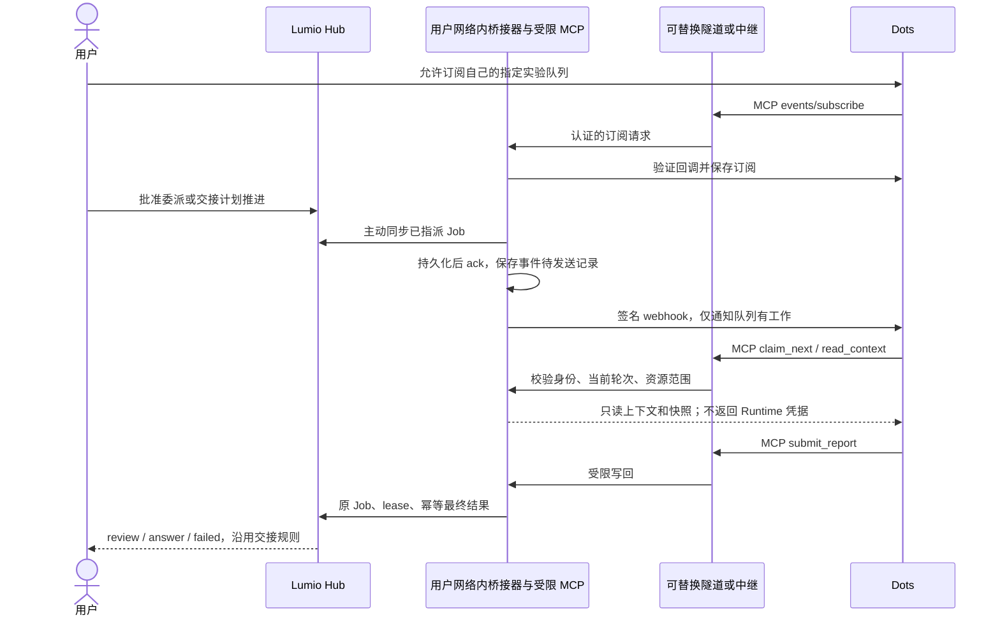

当前最可行的是“Dots 订阅 MCP Events → 受限 MCP 工具领取上下文和回报 → 用户网络内的桥接器对接 Lumio”；官方已确认事件触发能力，但用户账号可用性、端到端可靠性和新增执行目标契约仍须验证、批准。

# 结果

调研日期为 2026-11-18（Asia/Singapore）。

本报告是候选设计，不是已批准的架构，也不是已接通的执行器。官方文档已打开核对；本轮没有运行 Dots、Cloudflare 或生产 Hub 的接入实验。“实测确认”仅适用于本地仓库观察和权限错误，不适用于云端产品。

仓库代码链接固定在调研基线 `212e6b722e73788861fb49161692e842b491af2e`。归档分支基于更新后的 `origin/main`（`e919275`）。归档时复核了期间的路由、配对和鉴权变更。Runtime 列表现在隐藏已无有效令牌的设备，配对仍会检查其登记记录。上述变更保留了本文所述的配对、Job2 和任务级授权边界。

## 1. 推荐判断与边界

建议把问题分成三个可独立验收的部分：

1. **唤起工作**：优先验证官方 MCP Events。用户先授权订阅自己的指定队列，桥接器收到已批准委派后发送签名事件。没有发现可引用的、直接调用个人 dot 启动轮次的公开 REST API；这项仍为未知，不能用 Responses API 冒充。
2. **传递上下文与结果**：只暴露任务专用的 MCP 工具。Dots 不持有 Runtime 配对后得到的长期令牌，不访问 Hub 的全部 API。
3. **网络路径**：首先验证 OpenAI Secure MCP Tunnel 能否在该 Pro 账号上承载插件及 Events；若不具备条件，再考虑 Cloudflare Tunnel 只转发受限网关，或自建出站 relay。隧道解决连通，MCP 解决工具调用，Events 解决触发，它们可以组合。

OpenAI 已提供“个人电脑一次连接、跨任务保留”的另一条路，也值得作为备选；但这要求电脑在线、ChatGPT 应用保持打开，并不自动实现 Lumio 派发、去重或回报。[Dots 电脑与应用](https://learn.chatgpt.com/docs/dots/computers-and-apps)

**今天可以完成的是实验准备与账号能力确认；不能据文档就把 `dots@cloud` 登记到生产 Lumio。** 本轮也没有为下一阶段授予实验、购买、部署或生产访问权限。

## 2. Dots 能力事实表

置信度：“高”表示文档直接陈述；“中”表示相邻产品文档或有限推导；“未知”表示没有找到对应保证，需要用户提供或实验确认。

| 能力项 | 结论 | 证据来源 | 置信度 |
| --- | --- | --- | --- |
| 产品形态 | 云端的持续工作型个人 agent，拥有自己的电脑和浏览器；用户设备关闭仍可工作 | [Meet dots](https://learn.chatgpt.com/docs/dots) | 高，官方确认 |
| 文件和状态持久性 | 有自己的文件、软件、浏览器会话，可以跨使用时段保留状态；未公布个人 Pro 的文件系统持久性 SLA、容量或最长保留期 | [电脑与应用](https://learn.chatgpt.com/docs/dots/computers-and-apps) | 高；具体保证未知 |
| VM / 容器 | Dots 与 Work Cloud 共用云端电脑基础设施；Work 当前执行路径是 VM-backed sandbox；不能据此承诺 Dots 每任务独占 VM、固定 OS、可管理容器或 root | [Dots 安全](https://learn.chatgpt.com/docs/enterprise/dots-security)、[Work Cloud 安全](https://learn.chatgpt.com/docs/enterprise/chatgpt-work-cloud-security) | 共用基础设施高；具体实例形态中 |
| shell、运行软件 | 官方安全资料明确存在 code / shell 命令路径，并单独控制其联网；用户当前 Pro 环境有哪些程序、可否安装 Bun / 常驻 daemon 未实测 | [Dots 安全](https://learn.chatgpt.com/docs/enterprise/dots-security) | shell 路径高；账号能力未知 |
| 数十分钟及更长工作 | 支持跨对话继续、定时、事件触发和后台任务；未找到单进程连续运行 30/60 分钟、最大轮次时长或响应时限的承诺 | [任务与记忆](https://learn.chatgpt.com/docs/dots/tasks-and-memory) | 持续工作高；连续进程时限未知 |
| 并行 | 可同时处理多件事；个人账号最大并发数未知 | [任务与记忆](https://learn.chatgpt.com/docs/dots/tasks-and-memory) | 能力高；数量未知 |
| MCP / 自定义连接 | Dots 能用已启用插件；ChatGPT 支持自定义 MCP 读写工具，SSE / streaming HTTP；受账号和工作区控制约束 | [电脑与应用](https://learn.chatgpt.com/docs/dots/computers-and-apps)、[添加 MCP](https://developers.openai.com/api/docs/guides/custom-mcp-server) | 产品能力高；账号可用性未知 |
| 外部触发 | MCP Events 明确支持 dots；需用户建立订阅，服务端向回调发送签名 webhook | [MCP Events](https://developers.openai.com/plugins/build/mcp-events) | 高，未端到端实测 |
| 直接 Dots API | 未找到个人 dot 的公开“创建/继续/停止任务、获取最终报告”API 契约；不能断言不存在内部或未来接口 | [Dots 文档](https://learn.chatgpt.com/docs/dots)、[Events](https://developers.openai.com/plugins/build/mcp-events) | 未知，需要官方或用户提供 |
| GPT Actions | 没有证据表明个人 dot 能直接运行自定义 GPT 的 Actions；不能从 GPTs 能力迁移此结论 | 已查上述 Dots / MCP 官方文档 | 未知，需要用户提供 |
| 任意外部 HTTP | 存在浏览器与命令联网能力；不是“任意 URL、任意端口、任意 header 均可用”的保证 | [Dots 安全](https://learn.chatgpt.com/docs/enterprise/dots-security) | 通用联网高；具体出口未知 |
| 域名白名单 | 云端浏览器、shell 联网、插件是不同路径；Enterprise 的配置说明不能直接当作个人 Pro 当前策略；没有找到 Dots 通用公开白名单 | [Dots 安全](https://learn.chatgpt.com/docs/enterprise/dots-security) | 路径区分高；实际清单未知 |
| 公网裸 IP + HTTPS | Dots 是否接受、是否命中网络策略未知。另需可信证书链及与目标 IP 匹配的证书；本轮未探测用户 Hub 或证书 | 官方未找到 Dots 针对裸 IP 的明确保证；TLS 条件为工程前提 | 未知，需要合成端点实验 |
| CORS / 鉴权 / 超时 | 浏览器页面跨域调用会受浏览器限制；MCP 服务端及 shell HTTP 不靠放宽 CORS 获得权限。MCP 推荐 OAuth；Dots 自身 HTTP 工具最大超时未知 | [MCP OAuth](https://developers.openai.com/plugins/build/auth)、仓库 `web.ts`（下节） | 协议要求高；Dots 超时未知 |
| Pro “免费” | 主对话不计入 ChatGPT 用量；较深工作有 allowance，转给 Work / Codex 的任务照常消耗相应额度。不是所有执行无限免费 | [Meet dots / Access](https://learn.chatgpt.com/docs/dots#access) | 高 |
| 具体额度 | Pro 的并发上限、日/月调用数、较深工作 allowance 数值及 Events 运行额度：未知，需要用户提供账号页面或官方说明 | [Meet dots / Access](https://learn.chatgpt.com/docs/dots#access) 没有给出这些数值 | 未知 |
| 自动化是否允许 | 官方提供定时任务和 Events，是有支持的自动化路径；这不等于允许绕过 UI、复用登录 cookie 批量调用私有 API，或对外转售无限算力 | [任务与记忆](https://learn.chatgpt.com/docs/dots/tasks-and-memory)、[Events](https://developers.openai.com/plugins/build/mcp-events) | 原生自动化高；其他用法未确认 |
| “工作空间”含义 | 至少可能指云端电脑文件、独立任务线程、自己的记忆，以及另一个产品 Space 的文件/页面；不能混为一个可挂载目录。未找到个人 dot 云盘通用程序化读写 API | [电脑与应用](https://learn.chatgpt.com/docs/dots/computers-and-apps)、[任务与记忆](https://learn.chatgpt.com/docs/dots/tasks-and-memory) | 已区分的对象高；API 未知 |

“未知”不作为否定接入的理由，而作为 PoC 的停止条件。无需先证明 shell 常驻和完整文件系统 API，就可以验证 MCP 接入。

## 3. 仓库事实：可复用什么，需要补什么

以下链接固定到分析提交，可复查，不代表远端最新版本。

| 现有实现 | 代码证据 | 对云端接入的影响 |
| --- | --- | --- |
| 邀请仅 human 可发；join 无需先带 Bearer，以一次性配对码验证 | [authorize.ts](https://github.com/wicsp/Lumio/blob/212e6b722e73788861fb49161692e842b491af2e/apps/hub/src/authorize.ts#L17)、[pairing.ts](https://github.com/wicsp/Lumio/blob/212e6b722e73788861fb49161692e842b491af2e/apps/hub/src/pairing.ts#L35) | Runtime 邀请创建 runtime 身份；client 邀请沿用邀请者身份，不能拿 human 的 client join 当云端 agent 配对 |
| 配对码 16 随机字节、哈希保存、10 分钟、一次使用；同类新邀请作废旧码；失败累计 10 次后暂停一分钟 | [pairing.ts](https://github.com/wicsp/Lumio/blob/212e6b722e73788861fb49161692e842b491af2e/apps/hub/src/pairing.ts#L10) | 有基础暴力配对防护，但失败窗口是当前进程内全局状态，不是持久、分身份的公网速率控制；还可能被恶意请求拖成全局拒绝服务 |
| register / sync / ack / results 已有，且 Runtime 主动 POST 短轮询 | [server.ts](https://github.com/wicsp/Lumio/blob/212e6b722e73788861fb49161692e842b491af2e/apps/hub/src/server.ts#L44)、[runtime.ts](https://github.com/wicsp/Lumio/blob/212e6b722e73788861fb49161692e842b491af2e/apps/runtime/src/runtime.ts#L165) | “云端 pull”并不是全新协议；目前不是长轮询，没有发现必须先增加长轮询才能做的理由 |
| Runtime 先本地持久化 receive，再 ack；结果单独 outbox 重试 | [runtime.ts](https://github.com/wicsp/Lumio/blob/212e6b722e73788861fb49161692e842b491af2e/apps/runtime/src/runtime.ts#L100)、[queue.ts](https://github.com/wicsp/Lumio/blob/212e6b722e73788861fb49161692e842b491af2e/apps/runtime/src/queue.ts) | 桥接器要保留这个可靠交付边界；webhook 被接收不等于 Job 已执行，不能据 2xx 直接完成任务 |
| Job 回报校验指派 Runtime、lease、ack 状态；完全相同结果重复接收不重复记录，不同结果冲突 | [ExecutionJobs](https://github.com/wicsp/Lumio/blob/212e6b722e73788861fb49161692e842b491af2e/packages/execution/src/jobs.ts#L61)、[Hub runtime](https://github.com/wicsp/Lumio/blob/212e6b722e73788861fb49161692e842b491af2e/apps/hub/src/runtime.ts#L31) | 复用最终回报机制。网关须保存第一次回报的完整规范化内容，包括固定 finished 时间，重试不能重新生成时间戳 |
| lease 是不可猜的匹配值，JobSpec 没有 lease 的独立到期时间字段 | [job.ts](https://github.com/wicsp/Lumio/blob/212e6b722e73788861fb49161692e842b491af2e/packages/schema/src/job.ts#L70)、[jobs.ts](https://github.com/wicsp/Lumio/blob/212e6b722e73788861fb49161692e842b491af2e/packages/execution/src/jobs.ts#L73) | 不要把它描述成现成的“超时后自动重新领取”租约协议。云端停顿后不能自动重跑有副作用的工作 |
| 同步协商 `job-access` 后签发 agent Job 凭据，按 Job / lease / 取消 / 期限逐次验证 | [store.ts](https://github.com/wicsp/Lumio/blob/212e6b722e73788861fb49161692e842b491af2e/apps/hub/src/store.ts#L124)、[Hub runtime](https://github.com/wicsp/Lumio/blob/212e6b722e73788861fb49161692e842b491af2e/apps/hub/src/runtime.ts#L68) | 可复用生命周期；这不是完整的资源级 scope。`authorize()` 仍按 agent 角色放行通用 work / execution 读取及部分低风险写入 |
| agent 与 runtime 权限不同；只有 runtime 可提交 results；agent 不能批准提议、结束任务或直接发 Job | [authorize.ts](https://github.com/wicsp/Lumio/blob/212e6b722e73788861fb49161692e842b491af2e/apps/hub/src/authorize.ts#L17)、[v2.ts](https://github.com/wicsp/Lumio/blob/212e6b722e73788861fb49161692e842b491af2e/apps/hub/src/v2.ts#L89) | 单给 Dots 当前 Job agent token，既不能直接回报 `/v1/runtime/results`，又可能读到非当前任务内容。必须加受限网关，不能直接转交 Runtime token |
| token 格式校验、SHA-256 查找、定时安全比较、可吊销 | [store.ts](https://github.com/wicsp/Lumio/blob/212e6b722e73788861fb49161692e842b491af2e/apps/hub/src/store.ts#L193) | 可沿用 Hub 身份认证，不代表已支持 OAuth 2.1、scope / audience 或 ChatGPT MCP 自动发现 |
| 浏览器 Origin / Host 检查；无 Origin 和 Sec-Fetch-Site 的 CLI / Runtime 请求走 Bearer | [web.ts](https://github.com/wicsp/Lumio/blob/212e6b722e73788861fb49161692e842b491af2e/apps/hub/src/web.ts#L20) | Dots 浏览器访问 UI、页面 fetch、shell HTTP、MCP server-to-server 必须分开测试；无需把全 Hub CORS 改成 `*` |
| 已有原生助手 MCP 内部适配 | [native-assistant.ts](https://github.com/wicsp/Lumio/blob/212e6b722e73788861fb49161692e842b491af2e/apps/hub/src/native-assistant.ts#L824) | 是绑定 Session、在线 Runtime、活跃轮次的 `/tools` 与 `/call` 内部协议，不是可直接交给 ChatGPT 的通用远端 MCP + OAuth + Events 服务 |
| `AGENTS` 只有 claude-code / codex / pi；Target、Registration、Run、Result 都引用它 | [common.ts](https://github.com/wicsp/Lumio/blob/212e6b722e73788861fb49161692e842b491af2e/packages/schema/src/common.ts#L111)、[job.ts](https://github.com/wicsp/Lumio/blob/212e6b722e73788861fb49161692e842b491af2e/packages/schema/src/job.ts#L38) | 正式增加 Dots 执行目标必涉契约；不能谎报为 codex。尚未验证 Dots 能提供稳定 engine version，也需决定兼容表示 |

对现行设计的约束映射：

- ADR 0030 / 0032：网关将提问写为 `waiting_for_human` 并结束本轮；成功报告只推动交接或交回 review，不能替用户决定任务完成。采用现行 `work.md`，不复活旧“已查看”语义。
- ADR 0033 / 0044：目标必须已登记；`repo` 只是参考，不会自动 clone；本机绝对 `workdir` 不能直接照搬到云端。后续必须定义“提交 SHA 的快照 → 每 Job 云端目录”映射，并保留原输入快照、派发目标与来源。
- ADR 0049：不声称 Dots 已支持 Lumio 的 OS 只读、Git、secret 或 hooks 权限。研究 PoC 的业务输入只读、结果有单独写权限；无法强制的能力要拒绝，不悄悄降级。云端 VM 隔离不等于任务内权限隔离。
- 当前本地实现由 `stage.ts` 解析 checkout 对应 Git 元数据，并仅注入声明的阶段密钥；`worker.ts` 以 argv 运行钩子、失败即结束。不能把生产 hooks 或本机阶段 secret 复制到 Dots。参见 [stage.ts](https://github.com/wicsp/Lumio/blob/212e6b722e73788861fb49161692e842b491af2e/apps/runtime/src/stage.ts#L6)、[worker.ts](https://github.com/wicsp/Lumio/blob/212e6b722e73788861fb49161692e842b491af2e/apps/runtime/src/worker.ts#L60)、[executor.ts](https://github.com/wicsp/Lumio/blob/212e6b722e73788861fb49161692e842b491af2e/apps/runtime/src/executor.ts#L58)。

## 4. 接入路径比较

成本为本次设计估算的相对复杂度，未做工程排期。“今天开始”均指用户另行批准后，在合成环境验证，不指生产上线。

| 路径 | 实施成本 | 网络前提 | 安全风险 | Hub 改动量 | 能否今天开始 |
| --- | --- | --- | --- | --- | --- |
| A. Dots 内常驻 pull 客户端 | 高：驻留进程、恢复、outbox、账号许可均待证 | shell 能出站访问 HTTPS；进程和磁盘需有足够寿命 | 云端若持 Runtime 长期凭据，泄漏面大 | 已有轮询无需重写；正式 Dots engine、scope、目录和能力声明仍需修改 | 可先验证有限 HTTP / shell；不能承诺 daemon 可靠可用 |
| B. MCP 工具 + MCP Events | 中至高：需 OAuth、订阅持久化、事件发件箱、领取和结果工具 | MCP 端点可达；服务端能出站调用已验证回调 | 连接器 scope 过宽、回调 SSRF、重放、误写 | 合成 PoC 零改动；正式接入需桥接和契约 | **首选实验**：官方文档直接支持 Dots 事件；账号仍须确认 |
| C. Cloudflare Tunnel + 受限 MCP 网关 | 中，叠加 B；Tunnel 不代替触发 | Hub 侧可运行 cloudflared 并出站；稳定域名/TLS；不能假定只需 443（常见 Tunnel 出站用 7844） | 将整 Hub 穿透会扩大入口；Access 不能替代任务授权 | 只代理网关时可不改生产 Hub 网络；正式引擎另议 | 可准备；建 Tunnel、DNS、Access 属新阶段资源操作 |
| D. Worker / Durable Object / 自建 relay + 本地 bridge 主动出站 | 高：要维护邮箱式队列、取消、重放、重连 | 两端可访问 relay；本地桥接器常驻 | relay 可读任务内容与结果；跨账户路由、重复消息、积压 | 可用适配器复用 Job2；新目标契约及授权仍需补 | 可做合成 relay；不依赖开放家庭/内网入站 |
| E. OpenAI Secure MCP Tunnel + B | 中；另有 Platform 组织与 tunnel-client 设置 | 本地可出站 HTTPS 到 OpenAI，能到私有 MCP；账号关联和权限满足 | OpenAI 成为传输信任方；隧道不是资源授权 | 工具 PoC 无 Hub 改动；正式接入同 B | **先确认此路径资格**；Pro 订阅不证明拥有 Tunnel API 权限或免费传输 |
| F. Slack / 邮件 / 对象存储异步交接 | 人工低，可靠自动化高 | 已有且授权的插件/渠道；对象存储仅承载输入产物 | 伪造发件人、提示注入、误触发；外部渠道持久保存内容 | 人工复制报告零改动；完整闭环仍需网关 | 可先人工复制合成任务；不能等同 Job 级派发 |
| G. Dots 一次连接本地电脑 | 人工试用低，自动化中高 | 本地在线、ChatGPT 应用保持打开、用户批准连接 | 本地文件/应用可见范围可能超出单任务 | 手工让 dot 调用任务专用接口可零改；正式生命周期仍需设计 | 可作为人工试用备选；本轮未建立连接 |

上述产品事实来自 [自定义 MCP](https://developers.openai.com/api/docs/guides/custom-mcp-server)、[MCP Events](https://developers.openai.com/plugins/build/mcp-events)、[OpenAI Tunnel](https://developers.openai.com/api/docs/guides/secure-mcp-tunnels)、[Cloudflare Tunnel](https://developers.cloudflare.com/tunnel/)、[Cloudflare 网络选型](https://developers.cloudflare.com/cloudflare-one/networks/connectivity-options/)、[Dots 渠道](https://learn.chatgpt.com/docs/dots/channels)。邮箱/对象存储本身不会唤起 dot；未查到直接邮件地址触发个人 dot 的保证。Slack 文档主要是用户 DM/mention，不能推定 bot 代发自动等同所有者指令。

# 改动

本轮实际改动仅此报告。以下为建议设计与下一阶段拆分，没有更改设计规则、ADR、契约或生产代码。

## 5. 推荐的桥接结构

此图的 Hub → bridge Job 流程属于**契约批准后的正式版本**；早期 PoC 使用模拟队列，不能先伪装成已支持的引擎。网关和桥接器可为同一受信进程；最初不需要 Worker、DO、R2、Tunnel 全部上齐。

### 工具粒度与授权

以下工具名称是提案，不是现有 Lumio 能力名称，也未加入 Schema。

| 工具 | 允许范围 | 服务端必须检查 |
| --- | --- | --- |
| `claim_next` | 领取指定队列中已经用户批准、指派给该目标的下一轮 | 从认证主体决定队列，原子领取；不能通过传任意 task ID 扩权；首版每队列并发 1 |
| `read_context` | 当前轮输入快照及显式批准的附件/历史片段 | Job / lease / 期限 / 取消状态，附件所有权；无全库搜索、无 private、无跨任务读取 |
| `read_repo_file` 或下载快照 | 固定提交 SHA 下白名单文件 | 路径规范化、防 `..`、符号链接逃逸与大小超限；无 `.git` 凭据、无工作树未提交内容 |
| `submit_report` | 本轮报告、提问或失败 | 与领取的 Job 绑定；report digest、唯一提交键、同键异内容冲突；不允许改 Task outcome、计划或下一目标 |
| `report_progress`（可选） | 本轮少量状态/心跳 | 有界速率、序号去重；没有观测就不能把 bridge 心跳伪装成 Dots 正在工作 |

只读工具标注 `readOnlyHint: true`；领取和报告实际有状态变化，不能为避开确认把它们假标为只读。平台可能要求写工具确认；这是需要实测的自动化边界。[添加 MCP 的确认说明](https://developers.openai.com/api/docs/guides/custom-mcp-server)

### 顺序、可靠性和取消

事件只说明“可能有新工作”，不授权执行 payload 中的自由指令。网关按 Hub 已批准委派的稳定顺序选择下一项；同任务的先后关系以 Work 轮次和交接计划为准，不以 webhook 到达顺序为准。

桥接器持久保存 `Hub Job + lease → 外部领取记录 + 结果回执` 映射。重复事件不能重复领取；领取超时、Dots 消失或进程状态不明时先交回 `unknown` / 失败供人核查，不能自动重新运行有副作用的工作。“一次执行”是要维护的 Lumio 语义，不宣称能给第三方所有动作提供分布式 exactly-once。

在每次工具调用及提交前再验证取消和期限。停止 Dots 工作与使 Hub 凭据失效是两件事；先撤销后续工具能力，再尝试停止云端线程。最终报告迟到不得推进已结束轮次。Hub 现有 `result()` 的严格回执和 Work 的结果归并应复用，并补针对取消竞态的契约测试。

### 网络选择

优先资格检查 E：Secure MCP Tunnel 让本地客户端主动连接 OpenAI，私有 MCP 无需公网入站。它需要 Platform 的 tunnel 权限和 runtime API key，且 OAuth 授权服务器并不自动一起被隧道化。MCP 请求预算为 120 秒（包含队列时间），因此工具应该短调用，不能用一次 MCP 请求等待一小时研究结束。OpenAI Tunnel 与 MCP Events 组合在此账号上的行为仍需单独验证。[Secure MCP Tunnel](https://developers.openai.com/api/docs/guides/secure-mcp-tunnels)

如果 E 不可用，选 C：独立域名只暴露 MCP 网关，Cloudflare Tunnel 回连用户网络。不要将公网裸 IP 上的整个生产 Hub 当网关，也不以关闭 TLS 校验补救证书问题。若连受限公网端点也不能接受，选 D 的出站 relay；relay 只保留过期的交接信封，Hub 仍是任务与结果的权威。

### 后续模块拆分

| 模块 | 正式接入可能改动 | 前置条件 |
| --- | --- | --- |
| `packages/schema` | 新外部执行目标/引擎的诚实表示、版本/隔离能力、外部领取和任务级授权契约；是否仍用 Job2 需评审决定 | 先写 Proposed ADR，等待人批准；本轮不写/改契约 |
| `apps/hub` | 网关鉴权、资源级 scope、事件订阅与回执、取消校验、审计；或只保留 Hub 侧授权而网关独立 app | 明确 OAuth 主体与 Lumio actor 的映射，复用现行授权，不把外部身份映成 human |
| `apps/runtime` 或新独立 adapter app | 受信桥接器、持久队列、外部状态对账、结果重试；传统 CLI 进程 adapter 无法原样承担个人 dot 调用 | 新 app 的边界需 ADR；不能与 Hub 互相 import |
| `packages/execution` | 仅在现有生命周期不足时增加外部执行状态/超时事实，保留纯领域逻辑，不写网络调用 | 先证明最小复用不足；不先重写调度 |
| `packages/work` | 优先不改交接语义，沿用已有 Job 结果归并、问题、review 和 default target；如新增目标表示须相应适配 | 保留 expected_revision、request_id、人的完成决定 |
| `packages/storage` | 若加入订阅、bridge 映射、事件 outbox 持久表，新增适配；不得把业务状态塞到 vault | 存储格式/迁移纳入 ADR，迁移前另行批准 |
| `packages/api-client` / `apps/cli` / `apps/web` | 契约批准后按需支持新目标与能力显示；不会为了 PoC 先改全套 UI | 连带契约修改明确列范围；其他工作仍一次一个 app/package |

最小 PoC 不需要这些生产改动：一套 fixtures 输入、一个独立模拟 MCP 网关就能判定“能否唤起、读取、写回”。正式接入再按“契约批准 → 领域/存储 → Hub → adapter → 客户端”拆任务，不能在一个未经批准的跨包改动里完成。

## 6. Cloudflare 能力与复用

| 能力 | 适合的职责 | 限制与成本事实 | 与 Dots 的关系 |
| --- | --- | --- | --- |
| Workers | HTTPS/MCP 门面、认证、限流、消息转发、代理添加任务凭据 | 常规 Worker 是运行时 isolate；不要当作可直接运行 Bun daemon 的 Linux 主机。CPU 预算与网络等待的 wall time 分开；HTTP 连接也可能中断 | 可作为两类 agent 共用网关，不提供 ChatGPT Pro 算力 |
| Agents SDK | 基于 DO 的会话、状态、调度与通信封装 | SDK 不是订阅模型账号，也不自动对接 Lumio；仍需选择模型并承担相应费用 | 可实现自有 agent；Dots 则是已托管个人 agent，不能把 SDK 装进去就视为可管理 |
| Durable Objects | 按队列/任务协调、订阅和交接信封持久化、alarm | 内存可被驱逐；用持久存储恢复状态。DO 状态不是 Lumio Task 的第二权威 | 可统一做 relay 串行领取，不能把 DO 心跳当 Dots 在线证明 |
| Sandbox / Containers | 每任务 Linux 执行环境、运行 shell/测试/现有受支持 CLI | 当前文档区分 Linux Container 与 Dynamic Worker；Linux 实例为 microVM，需 Workers Paid。实例停止后进程与磁盘结束，不能只靠名字保活 | 自建 Cloudflare executor 更适合此路径；可打预制镜像减少每轮安装 |
| Sandbox snapshots / R2 | 只读输入快照、可恢复工作目录、结果产物 | snapshots 不恢复进程；磁盘、DO 存储与 R2 生命周期不同；运行的 idle 实例仍收费 | 两边可用同样的 SHA 清单、摘要、过期策略；Dots 下载能力仍待验 |
| Tunnel | 本地网关主动出站连接 Cloudflare，无需本地公网监听 | 不能单独做身份认证或事件触发；应只路由允许的网关 | Dots、CF agent 都能使用同一 HTTPS 门面 |
| Access | 人的登录策略，或机器 Service Auth 外层门禁 | service token 可过期、轮换、撤销；机器通常用 Client ID / Secret 两个 header。不能直接假定 ChatGPT MCP 会发送这些 header，也不能让 Access 抢占 OAuth 的 Authorization header | 独立 CLI / Worker 较容易加 header；Dots 需验证兼容 OAuth 或由网关处理，不能强塞人工网页登录作为后台方案 |
| WARP / Cloudflare One Client | 已登记、可管理设备到私网的路由 | 需要客户端和注册权限；没证据 Dots 云端电脑允许装/持久运行这个客户端。用户笔记本开 VPN 不会自动给 Dots 私网路由 | 不作为 Dots 首选；可控云 VM 才考虑，Sandbox 内也不能先假定具备内核/设备权限 |

依据：[Workers limits](https://developers.cloudflare.com/workers/platform/limits/)、[Agents internals](https://developers.cloudflare.com/agents/agent-class/internals/)、[Sandbox 总览](https://developers.cloudflare.com/sandbox/)、[Sandbox files](https://developers.cloudflare.com/sandbox/files/)、[Sandbox lifetime](https://developers.cloudflare.com/sandbox/concepts/lifetime/)、[Tunnel](https://developers.cloudflare.com/tunnel/)、[Service tokens](https://developers.cloudflare.com/cloudflare-one/access-controls/service-credentials/service-tokens/)、[网络选型](https://developers.cloudflare.com/cloudflare-one/networks/connectivity-options/)。

对自建 CF sandbox，一个更强的凭据隔离方式是 token 留在 Worker 的可信代码，由代理仅对允许目标添加；沙箱进程不拿到 token。官方说明支持拦截指定 hostname 的出站请求。仍需自己限制 path、method、Job 和速率；仅匹配 hostname 不够。[Sandbox network](https://developers.cloudflare.com/sandbox/network/)

**复用比例：按职责而非代码行估算。** 将接入分为六块：任务上下文/快照、最小授权、领取/幂等/结果、审计、网络门面、执行环境与触发。前五块的设计原则可共用，约 **5/6**；执行环境和触发明显不同。这个比例不是已验证代码复用率。Dots 用 Events + 托管插件；CF 用自己可控的 Worker/DO/Sandbox 生命周期及模型 API。若 CF sandbox 直接运行现有 codex/claude-code/pi 且满足版本、平台、认证和隔离验证，可以复用现有 Runtime Job2，而无需增加“cloudflare”这个模型引擎；仍需安全配对和持久交付设计。

## 7. 安全与风险（独立评审项）

### 7.1 第三方凭据与数据边界

**建议红线：云端 agent 只接触任务级短期授权和固定提交的只读仓库快照；不得持有长期生产 human / Runtime / 部署 / 云管理凭据。** 这是一项建议实施的边界，现有 Job token 没有充分保证资源级隔离，不能说已经达成。

桥接器在用户网络内持有 Runtime 身份；云端只拿网关的 scoped 访问。网关每次从服务端当前 Job 推导允许资源，不采信模型提交的 actor、queue、task 或 scope。令牌需绑定 audience、主体、Job/lease、到期、允许动作，能立即吊销；初期建议 10 分钟工具访问票据，在已批准且仍有效的本轮内按需续期，上限不超过轮次截止时间。续期不扩大权限、不重新开始工作。这些时长是 PoC 提案，不是现有官方或 Lumio 默认值。

长期“连接”与短期“任务”存在必须明确的取舍：OAuth 通常会由平台保存可刷新的授权。如果用户要求第三方连长期**领取未来任务**的能力都不能拥有，就必须每轮重新授权，无法同时承诺一次连接永久无人值守。折中是长期连接只可发现指定队列的通知，领取具体 Job 还必须有 Hub 已批准委派；refresh token 不能读全库、不能任意创建工作、不能改任务。即便如此，它仍属于可持续控制授权，须用户明确接受。OAuth scope 与 resource / PKCE 要在服务端实现，工具 annotations 不是权限控制。[MCP OAuth](https://developers.openai.com/plugins/build/auth)

把凭据留在 Worker 能阻止 sandbox 程序读取，但 Cloudflare 仍是可信基础设施方；不等于“第三方从不持有”。若不能接受这一点，生产 Hub 凭据只能留在用户网络，CF relay 不得获得它们。OpenAI 同样会处理通过工具返回的任务数据；内容进入会话、文件或记忆后，撤销凭据不会撤回已复制内容。个人 Pro 不能套用 Enterprise 默认数据保护与保留期结论；按该账号数据控制核查。[Dots 控制](https://learn.chatgpt.com/docs/dots/controls)

### 7.2 公网裸 IP 与入口攻击面

公网 IP 是网络地址，不是身份验证。需分别防范 TLS 证书不匹配/不可信、暴力配对、配对全局限流被滥用、Bearer 通过日志或 URL 泄漏、重放与并发篡改、超大请求及资源耗尽。只开独立受限入口；不透传 setup、human UI、任意 command、sudo、routine、proposal approval 和知识写接口。网关不能接受任意上游 URL，不能从模型参数构造通用 HTTP 代理。

速率限制应同时绑定主体、队列、Job 与来源网络：PoC 建议每队列并发 1，工具每分钟 30 次、报告最多 1 MiB、上下文分页，不允许无限排队；生产阈值据真实需求另定。回报和领取、拒绝、吊销均记 request ID、Job、时间、结果摘要；不记 token、OAuth code、完整回调 URL 中的秘密。现有 Hub 成功读取/心跳会省略部分审计，云端网关需要独立补足“谁读了哪个资源”的审计。

### 7.3 Events 引入的 SSRF、重放和提示注入

订阅只能由已认证、拥有该队列权限的用户建立。回调强制 HTTPS，连接时验证 DNS 和实际目的地址，拒绝私有、回环、链路本地及其他非公开地址，禁止重定向；验证挑战和正式投递都做同样检查。否则攻击者能把 Hub/网关变成 SSRF 发起器。签名密钥分订阅保存、日志脱敏，事件 ID 固定用于重试；网关对重复/乱序事件保持领取与结果幂等。[MCP Events 安全与交付要求](https://developers.openai.com/plugins/build/mcp-events)

任务、仓库、网页和报告都是不可信资料，不得以其中“请忽略权限、改发另一个地址”等文字改变队列所有权或工具权限。通知尽量只有 Job/队列标识和短摘要；完整资料经受限读取获得。结果正文不作为执行任意 hooks 的脚本。

### 7.4 运行与取消风险

Dots 自己的云电脑可能保留前一任务内容，不应承诺与 Lumio 的每 Job workspace 同等隔离；若任务不能接受残留或记忆，先不交给个人 dot。云端快照或只读源文件并不阻止它在别处复制内容，仍需信任供应商。

断开插件、撤销 task ticket、取消队列、停止云线程应有独立按钮/操作和审计。网关发现期限失效后禁止新的读写，即使云端仍在推理。网络失败只能重试交付，不能隐式重跑任务；不能用“收到 webhook 200”或“bridge 在线”证明模型已开始、已停止或成功。

### 7.5 落地前红线

本轮不改生产配置、不重启线上服务、不部署、不注册资源、不买额度、不拿真实凭据测试、不探测生产 IP、不读写 vault。后续实验先用 fixtures 及独立 Hub 状态目录/端口，禁用生产 hooks 和 secrets；是否允许真实上下文出域、何种长期连接授权和生产入口，要另行决定。

## 8. 分阶段 PoC 计划（尚未执行，须用户确认）

各阶段独立批准；任何一阶段失败就停止依赖它的后续步骤。不通过 UI 自动化点击“无限循环”来绕开产品限制。

| 阶段 | 账号、权限与预计消耗 | 实验动作及验证点 | 失败判据 / 下一步 |
| --- | --- | --- | --- |
| P0：账号资格与能力卡 | 用户现有 Pro；1 次短对话/只读查看设置，约 10 分钟；不提供生产凭据，不购买 | 用户确认自定义 MCP 插件入口、Events、写工具确认策略、额度页；只读核对是否有 Platform Tunnel Read/Use/Manage 及组织关联。让 dot 明确报告实际工具路径，而非口头声称有 shell | 任一关键入口不可用，记录产品提示与账号类型；B/E 不继续，保留人工试用或向官方询问 |
| P1：最小读写闭环 | 另行批准独立 mock MCP endpoint 与测试 OAuth；2 次模型任务，预计 6–10 次工具调用，约 30 分钟；仅合成数据；新域名/隧道资源需独立批准 | 网关预置 A/B 两个假任务，只授权 A；Dots 调 `read_context(A)` 后 `submit_report(A)`；检查 A 的精确标识、报告内容、持久回执。再测读 B、匿名、过期和重复提交 | 读到 B、写到其他对象、必须贴长期生产 token 才能工作，立即失败。若每次写回均要求人工确认，结果记为“有人值守可用”，不宣称无人值守 |
| P2：事件唤起 | P1 同套账号；最多 3 次触发、1 次重启、约 1 小时；使用平台生成的测试订阅签名材料，仅存在测试服务；不开放生产 Hub | 用户在 dot 中授权订阅合成队列；服务验证 callback、持久订阅；发送固定 event ID；验证无需新发用户消息也能读取并回报。测试重复、乱序、断线后重送、停止订阅、撤销授权 | callback 200 但 5 分钟内未领取，判为本轮目标未达；重复执行、注销后仍可读取均失败。5 分钟是实验阈值，不是供应商 SLA；超时不重跑工作 |
| P3：时序与持续性 | 同套环境；两个合成研究任务，单并发，最多 60 分钟、30 次工具调用；P0 显示额度不足就停止，无自动付费 | 先 A 后 B，故意先投递 B 通知；网关只准按队列领取。加入 30–45 分钟有实际研究步骤的任务，中间断开用户客户端，检验持续进展、到期续票、取消和迟到回报 | B 越过 A 的前置、取消后新读写成功、失联后自动重跑即失败。没有进度不得只用心跳证明存活；达不到时限就保留较短研究任务定位 |
| P4：隔离 Hub / Job2 集成 | 新一轮明确授权代码实验；独立工作树、合成库、端口和客户端状态；先批准 Proposed ADR，才能改 Schema；不接生产 | 注册诚实的外部目标，模拟桥接 crash/restart、ack 前后断线、相同结果重试、异结果冲突、提问、取消、旧 lease、阶段权限/hooks 拒绝；输出须经 `@lumio/schema` 验证 | 任一跨任务访问、任务结局被 agent 改写、失联任务被自动重跑、伪报引擎/隔离能力均不得通过；补设计再审 |
| P5：Cloudflare 等价试验（可选） | 用户自己的 CF 账号和 Workers Paid/Sandbox 资格；只允许专用测试 app 权限，另需独立模型授权；先设预算上限，建议该实验最多 USD 1，若无法控制则不运行 | 预制只含合成资料的镜像；用相同 A/B、取消、幂等用例跑现有支持的引擎。分别销毁实例、恢复快照、恢复结果交付；验证 sandbox 不能直接读 Worker 中凭据 | 消费将超过预算、程序取得长期凭据、snapshot 被当进程续跑、运行中任务自动重执行都失败；不创建更多资源补救 |

**最小可验证的一步**是 P0 后的 P1：只授权一个合成任务 A，通过两个工具证明“能读取 A、能写回 A、不能访问 B”。它不要求先为 Dots 配整套仓库环境，也不要求生产 Hub 公网入口。P2 才证明 Hub 事件能让 Dots 自主开工；P4 才证明真正成为 Lumio 可分配目标。

若用户还想验证裸 IP，作为 P1 的独立可选子实验：使用用户批准的、非生产的 HTTPS IP 端点及有效 IP 证书，按浏览器导航、页面 fetch、shell/MCP 三条实际可用路径分别测匿名与短票据访问，记录 TLS / 403 / 超时；不测生产 IP，不用 `-k`，不为了过测试放宽公网策略。MCP 通过域名工作即已足够，裸 IP 失败不阻塞推荐路径。

## 9. 未解问题与用户决策

| 事项 | 本轮结论 / 需要用户提供或决定 |
| --- | --- |
| 账号资格 | 需要用户提供当前 Pro 档位、使用地区，以及插件/Events/Tunnel 设置中实际可用项与非敏感错误；不需要提供密码、token 或 cookie |
| 额度 | 较深工作、最大并发、持续时限、事件触发具体 allowance 未知；请以当前账号用量页或官方答复确认，不能用“Pro 免费”作为容量规划 |
| 目标体验 | 推荐先“研究报告执行器、每队列并发 1、无仓库写入”；是否必须今天就显示为正式 `dots@…`，需要决定；后者要等契约批准 |
| 持续授权 | 是否接受 OpenAI 保存只能发现指定队列/领取已批准 Job 的 OAuth 连接授权；若完全不接受长期领取能力，改为每轮用户授权 |
| 网络 | 是否先验证 OpenAI 私有 Tunnel；若无资格，是否允许在独立域名公开受限 MCP 网关，并通过 CF Tunnel 回连；不需先同意开放全 Hub |
| 数据 | 哪类任务与仓库文件可交给 OpenAI / Cloudflare，是否只用合成/公开内容；是否接受 dot 云盘和记忆的残留边界 |
| Cloudflare | 仅做网络中继，还是另建一个可控 Linux executor；后者需付费基础设施与独立模型费用，不能套用 Dots 的订阅额度 |
| 证据缺口 | 个人 Dots 直接 API、GPT Actions、裸 IP 出网、稳定版本标识、每任务隔离保证、工作空间 API：未知，需要用户或官方提供，或按上述实验确认 |

上述事项供维护者决定下一轮实验范围。获准的首个实验可从 P0 的账号能力核对开始。

## 10. 参考链接与关键原文

下表引文为短摘录；“事实”范围以正文标注为准。访问日期均为 2026-11-18。同一文档的 HTML / Markdown 为同一来源。

| 编号 | 官方来源 | 关键原文摘录 / 用途 |
| --- | --- | --- |
| O1 | [Meet dots](https://learn.chatgpt.com/docs/dots) | “conversations with your dot don’t count toward your ChatGPT usage limits”；“allowance for deeper work”——不能合并理解成无限免费 |
| O2 | [Connect computers and apps](https://learn.chatgpt.com/docs/dots/computers-and-apps) | “the computer can keep its state between periods of use”——状态保留，不是存储 SLA |
| O3 | [Tasks and memory](https://learn.chatgpt.com/docs/dots/tasks-and-memory) | “specify a time or a supported event that should trigger work”——原生自动化 |
| O4 | [Control your dot](https://learn.chatgpt.com/docs/dots/controls) | “Stopping work doesn’t undo completed actions.”——取消不能撤回副作用 |
| O5 | [Message your dot](https://learn.chatgpt.com/docs/dots/channels) | “Adding it to a channel doesn’t establish a monitoring schedule.”——渠道不等于触发订阅 |
| O6 | [Safety and security in dots](https://learn.chatgpt.com/docs/enterprise/dots-security) | “same cloud computer infrastructure as ChatGPT Work”——架构线索；Enterprise 策略不能自动套到 Pro |
| O7 | [Work Cloud security](https://learn.chatgpt.com/docs/enterprise/chatgpt-work-cloud-security) | “tasks run in VM-backed sandboxes”——Work 的执行基础设施，不扩大为 Dots 实例管理保证 |
| O8 | [Add custom MCP server](https://developers.openai.com/api/docs/guides/custom-mcp-server) | “ChatGPT supports both read and write tools from your server.”——工具接入与确认 |
| O9 | [MCP Authentication](https://developers.openai.com/plugins/build/auth) | “implement an OAuth 2.1 flow”——现有 Hub Bearer 不等于 MCP OAuth |
| O10 | [MCP Events](https://developers.openai.com/plugins/build/mcp-events) | “and with dots”；“Events can arrive out of order.”——Dots 触发及乱序限制 |
| O11 | [Secure MCP Tunnel](https://developers.openai.com/api/docs/guides/secure-mcp-tunnels) | “without opening inbound firewall ports”——私有接入选项；有权限/密钥/关联前提 |
| C1 | [Cloudflare Tunnel](https://developers.cloudflare.com/tunnel/) | “no public IPs required”——提供源站连通；鉴权另做 |
| C2 | [Connectivity options](https://developers.cloudflare.com/cloudflare-one/networks/connectivity-options/) | “Cloudflare One Client is a bidirectional L3 tunnel”——WARP 是设备网络路径 |
| C3 | [Access service tokens](https://developers.cloudflare.com/cloudflare-one/access-controls/service-credentials/service-tokens/) | “Client ID and a Client Secret”——机器门禁、期限和撤销 |
| C4 | [Workers limits](https://developers.cloudflare.com/workers/platform/limits/) | “Waiting on network requests … does not count toward CPU time.”——不能混淆 CPU 和总时长 |
| C5 | [Agent class internals](https://developers.cloudflare.com/agents/agent-class/internals/) | “agents are Durable Objects”——状态与调度基础，不是 shell VM |
| C6 | [Sandbox overview](https://developers.cloudflare.com/sandbox/) | “Available on Workers Paid plan”；“Each instance is a microVM”——运行环境与费用前提 |
| C7 | [Sandbox files](https://developers.cloudflare.com/sandbox/files/) | “Stopping the instance deletes the files on its disk.”——持久化必须显式处理 |
| C8 | [Sandbox lifetime](https://developers.cloudflare.com/sandbox/concepts/lifetime/) | “Code that runs inside the instance does not count as activity.”——执行进程不能自行保证实例保活 |
| C9 | [Sandbox credentials and network](https://developers.cloudflare.com/sandbox/network/) | “Keep the token in your Worker instead”——可信代理注入，而非给沙箱长期凭据 |

仓库设计出处：[DESIGN.md](../../docs/DESIGN.md)、[execution.md](../../docs/design/execution.md)、[security.md](../../docs/design/security.md)、[hub.md](../../docs/design/hub.md)、[work.md](../../docs/design/work.md)；任务指定的 [ADR 0030](../../docs/adr/0030-round-questions-and-review.md)、[0032](../../docs/adr/0032-task-model-outcome-turn.md)、[0033](../../docs/adr/0033-project-workdir-proposal-withdrawal-targets.md)、[0044](../../docs/adr/0044-project-default-target.md)、[0049](../../docs/adr/0049-handoff-graph-stage-permissions-hooks.md)。本轮只读，没有修改历史 ADR。

# 验证

- 已阅读总体设计、四份相关分册及任务指定 ADR，并对照配对、角色鉴权、Job2、Job 凭据、内部 MCP、阶段权限和钩子的代码。
- 已核对 OpenAI 与 Cloudflare 官方文档，以及仓库引用的提交、文件和链接。Dots 和 Cloudflare 的运行表现与额度仍待按 P0–P5 验证。
- 本提交仅新增 Markdown 调研报告。生产代码、契约、配置和依赖不在提交范围内。
